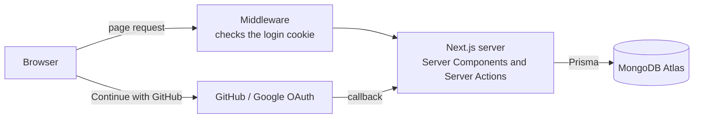

# CodeShelf

Save, search and share your code snippets.


CodeShelf is a full-stack web app for developers who keep losing useful code. Sign in with GitHub, write a snippet in the Monaco editor (the editor inside VS Code), add tags, find it again with search and filters, and share a link when someone asks how you did it.

## Features

- **Passwordless login** with GitHub (Google is optional), built on Auth.js with JWT sessions
- **A real code editor:** Monaco, with 22 languages and a coloured "spine" on each card that shows the language
- **Server-side syntax highlighting** with highlight.js, so the browser downloads no highlighting library
- **Tags, favorites and search** across title, description, code and tags, with filters for language, tag and favorites. Filters live in the URL, so a filtered view can be bookmarked or shared
- **Private by default.** Make a snippet public to get a share link (`/s/<id>`)
- **Raw endpoint** for terminals: `curl https://<your-site>/api/snippets/<id>/raw`
- **Save to my shelf:** copy someone else's public snippet into your own account
- **Protected routes and per-user authorization:** middleware guards `/dashboard`, and every change is checked against the signed-in user
- **Server-side validation** with Zod
- Responsive layout, loading skeleton and a custom 404 page

## Tech stack

| Area | Technology |
| --- | --- |
| Framework | Next.js 15 (App Router, Server Components, Server Actions, Middleware) |
| Language | TypeScript |
| Database | MongoDB Atlas |
| ORM | Prisma |
| Authentication | Auth.js (NextAuth v5), GitHub and Google OAuth, JWT sessions |
| Validation | Zod |
| Styling | Tailwind CSS v4 |
| Editor and highlighting | Monaco editor, highlight.js |
| Icons and fonts | lucide-react, Bricolage Grotesque, JetBrains Mono |

## How it works



- **Login:** the "Continue with GitHub" button calls a Server Action. After GitHub confirms the user, Auth.js finds or creates the user in MongoDB (through the Prisma adapter) and saves a signed JWT cookie.
- **Route protection:** middleware reads the cookie before each page request. `/dashboard` needs a login, and `/login` redirects signed-in users to the dashboard.
- **Reading data:** Server Components call small query functions in `src/lib/snippets.ts`. The search form puts filters in the URL, and the page turns them into a Prisma `where` filter.
- **Changing data:** forms call Server Actions in `src/actions/snippets.ts`. Each action checks the session, validates the input with Zod, then writes with a query that includes the user's id, so nobody can change another user's snippet.

## Design decisions

- **JWT sessions and a split auth config.** Middleware runs on the edge, where Prisma cannot run. `auth.config.ts` holds the edge-safe parts and `auth.ts` adds the database adapter.
- **Server Actions for forms, one route handler for raw text.** Less boilerplate than REST endpoints. The raw endpoint is a route handler because it returns plain text for tools like `curl`.
- **Authorization inside the query.** Writes use `where: { id, userId }`, and the share page only opens public snippets or the owner's own.
- **Filters in the URL.** Searches are bookmarkable and need no client state.
- **A MongoDB-friendly model.** Tags are an array inside each snippet, and there is an index on `userId`.
- **Highlighting on the server.** The browser receives ready-made HTML.

## Getting started

### Prerequisites

- Node.js 20 or newer
- A free [MongoDB Atlas](https://www.mongodb.com/cloud/atlas) cluster
- A GitHub account (for the OAuth app)

### Install

```bash
git clone https://github.com/roshan-kunchikorve/Ai-vibe_code.git
cd Ai-vibe_code
npm install
cp .env.example .env
```

On Windows use `copy .env.example .env`. `npm install` also runs `prisma generate`.

### Environment variables

| Variable | Required | What it is |
| --- | --- | --- |
| `DATABASE_URL` | Yes | MongoDB Atlas connection string, with the database name `codeshelf` before the `?` |
| `AUTH_SECRET` | Yes | Random string that signs login cookies. Generate one with `openssl rand -base64 32` |
| `AUTH_GITHUB_ID`, `AUTH_GITHUB_SECRET` | Yes | From your GitHub OAuth app |
| `AUTH_GOOGLE_ID`, `AUTH_GOOGLE_SECRET` | No | "Continue with Google" appears when both are set |
| `AUTH_URL` | No | Your site address. Recommended on hosts other than Vercel |

**MongoDB Atlas.** Create a free cluster, add a database user (Database Access), allow your IP address (Network Access), then copy the connection string from Connect > Drivers. URL-encode any special characters in the password.

**GitHub OAuth app.** Open <https://github.com/settings/developers>, choose **OAuth Apps**, then **New OAuth App**, and set:

- Homepage URL: `http://localhost:3000`
- Authorization callback URL: `http://localhost:3000/api/auth/callback/github`

Copy the Client ID and a new client secret into `.env`.

**Google (optional).** Create a Web application OAuth client in the Google Cloud console with the redirect URI `http://localhost:3000/api/auth/callback/google`.

### Run

```bash
npm run db:push
npm run dev
```

Open <http://localhost:3000>.

### Scripts

| Command | What it does |
| --- | --- |
| `npm run dev` | Start the development server |
| `npm run build` | Build for production |
| `npm start` | Run the production build |
| `npm run lint` | Check the code with ESLint |
| `npm run db:push` | Apply `prisma/schema.prisma` to your database |
| `npm run db:studio` | Open Prisma Studio to look at your data |

## Project structure

```
prisma/
  schema.prisma              Database models (Snippet, User and the Auth.js tables)
src/
  middleware.ts              Runs before pages and protects /dashboard
  routes.ts                  Which URLs are private
  auth.config.ts             Login providers and route rules (safe for the edge)
  auth.ts                    Full login setup (Prisma adapter and JWT sessions)
  actions/
    auth.ts                  Log in and log out
    snippets.ts              Create, update, delete, favorite, share, copy
  lib/
    db.ts                    One shared Prisma client
    snippets.ts              Database reads (list, stats, single snippet)
    validation.ts            Zod schema and tag cleaner
    languages.ts             The 22 supported languages and their colours
  components/                Navbar, SnippetCard, SnippetForm, FilterBar, CodeBlock, CopyButton, DeleteButton
  app/
    page.tsx                 Landing page
    login/page.tsx           Login page
    dashboard/
      (shelf)/page.tsx       Your snippets (with a loading skeleton)
      new/page.tsx           New snippet
      [id]/edit/page.tsx     Edit snippet
    s/[id]/page.tsx          Public share page
    api/auth/[...nextauth]/  Auth.js endpoints
    api/snippets/[id]/raw/   Raw code as plain text
```

## Deployment

CodeShelf deploys to [Vercel](https://vercel.com) with MongoDB Atlas.

1. Push the code to GitHub. Make sure `.env` is not committed (it is listed in `.gitignore`).
2. Import the repository in Vercel.
3. Add the environment variables from the table above.
4. In Atlas, allow network access from anywhere (`0.0.0.0/0`), because Vercel's IP addresses change. Use a strong database password.
5. Deploy. Then create a second GitHub OAuth app for production with the callback URL `https://<your-site>/api/auth/callback/github`, and use its keys in Vercel. A GitHub OAuth app allows only one callback URL.

Other hosts (Render, Railway, Docker) use the same variables. Also set `AUTH_URL` to your site address.

## Troubleshooting

| Problem | What to do |
| --- | --- |
| `Server selection timeout` or "Can't reach database server" | Atlas is refusing the connection. In Atlas, open Network Access and add your current IP address (or `0.0.0.0/0` while learning), wait until it shows Active, check that the cluster is not paused, and check the password in `DATABASE_URL`. If it still fails, try another network such as a phone hotspot. |
| `redirect_uri` error from GitHub | The callback URL in the OAuth app must exactly match `<your site>/api/auth/callback/github`. |
| `MissingSecret` error | `AUTH_SECRET` is empty. Generate one and restart the server. |
| The editor shows "Loading..." forever | Monaco loads from the jsDelivr CDN. Check your internet connection or ad blocker. |
| Build warning about the Edge Runtime and `DecompressionStream` | Harmless. It comes from a library used by the login middleware. |
| `npm warn deprecated eslint@9...` during install | Harmless. ESLint 9 is the version this release of Next.js supports. |
| Changed `schema.prisma` | Run `npm run db:push`, then restart `npm run dev`. |

## Roadmap

- [ ] Pagination (the shelf shows 60 snippets)
- [ ] Automated tests: Vitest for validation, Playwright for end-to-end flows
- [ ] Rate limiting on "Save to my shelf"
- [ ] Database-side counts for languages and tags
- [ ] Dockerfile and CI pipeline
- [ ] Collections or folders for snippets

## Author

Built by [Roshan Kunchikorve](https://github.com/roshan-kunchikorve).
